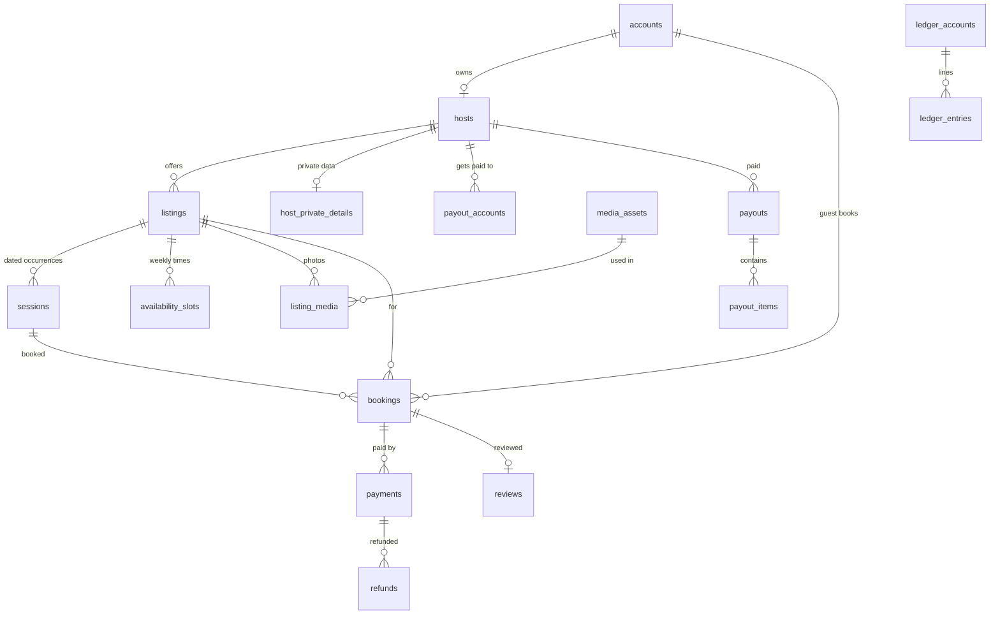

# Classnest backend and database: design document (v2)

Status: **draft for review**. Version 2 follows the decision to continue with **Node.js (TypeScript) inside the existing Next.js app and MySQL 8 on Hostinger Cloud Business** ("P1"). Nothing in this document is built yet.

Version 1 planned a Kotlin + Spring Boot service with PostgreSQL on a VPS. That path ("P3") is kept as the upgrade route (section 14). The Kotlin skeleton that was started in `backend/` has been deleted; it can be rebuilt from this design when the move happens.

## 1. Goals

- Replace the demo storage (`.data/db.json`, files in `uploads/`, a key in `.env.local`) with a real database and a real backend layer.
- Keep **one app, one deploy**: the Next.js site is both the frontend and the API.
- Stay cheap now and keep a clear path to a bigger setup: module boundaries and portable SQL, so the backend can be extracted later.
- Correctness first for money and capacity: bookings, payments, payouts.

Non-goals for now: microservices, a queue broker, a separate search cluster, multi-region.

## 2. Decisions and assumptions

| # | Decision | Status |
|---|---|---|
| D1 | Backend in **TypeScript on Node.js**, as route handlers plus service modules inside the Next.js app | confirmed (P1) |
| D2 | **MySQL 8.0+** (Hostinger-provided at first) | confirmed by P1. **Verify whether Hostinger's "MySQL" is really MariaDB** (it often is) and the version. The schema avoids MySQL-only features so both work, but `json` columns come back as strings on MariaDB and need a small custom type |
| D3 | **Drizzle ORM + `mysql2`**; migrations generated by `drizzle-kit` as SQL files kept in git. Liquibase is not used (it needs a JVM) | recommended |
| D4 | One app and one deploy: the existing Hostinger deploy keeps working | confirmed |
| D5 | Photos in **S3-compatible object storage** (Cloudflare R2), not on the server disk | recommended |
| D6 | Money in minor units (MKD has 2 decimals in ISO 4217, so 1500 ден = `150000`) | recommended |
| D7 | Background work through an `outbox_events` table and a **cron-triggered endpoint** (no broker, no Redis) | recommended |
| D8 | The Kotlin skeleton in `backend/` and its CI workflow were deleted | confirmed |

## 3. Architecture

```
Browser ──► Next.js app on Hostinger Cloud Business
              ├─ pages and components (UI)
              └─ src/app/api/**  route handlers   (thin: parse, check login, call a service)
                       │
                       ▼
                 src/server/modules/**  services    (all business rules live here)
                       │
              ┌────────┴─────────┐
              ▼                  ▼
        MySQL 8 (Drizzle)   Object storage (R2): photos, via pre-signed URLs

Hostinger cron (every minute) ──► POST /api/internal/cron/outbox   (Bearer secret)
                                   sends emails, makes thumbnails, expires holds
```

Rules:

- **Route handlers contain no business logic.** They validate input (Zod), check the session, call one service function and return JSON.
- **Modules own their tables.** A module may call another module's *service*, never its repository or tables. This keeps a later split cheap.
- **Outbox pattern.** A business change and its event (`booking.confirmed`) are written in one transaction. The cron endpoint processes events with retries. A failed email never breaks a booking.
- **Idempotency** on every retryable write (booking, payment, webhook).
- **Stateless requests.** No data in process memory that must survive a restart (Node processes on shared hosting restart often).

### Folder structure (inside the Next.js project)

```
src/app/api/**             # route handlers (thin)
src/server/
  db/                      # client.ts (pool), schema/*.ts (Drizzle tables)
  modules/
    identity/  hosts/  listings/  availability/  bookings/
    payments/  payouts/  reviews/  messaging/
      service.ts  repo.ts  schema.ts  types.ts      # per module
  platform/                # config.ts (Zod-checked env), crypto.ts, storage.ts,
                           # outbox.ts, audit.ts, idempotency.ts, rate-limit.ts
drizzle/                   # generated SQL migrations (committed)
drizzle.config.ts
```

## 4. Conventions for all tables (MySQL 8)

- Names in `snake_case`, tables plural. Engine InnoDB, charset `utf8mb4`, collation `utf8mb4_unicode_ci` (case-insensitive, and available on both MySQL and MariaDB).
- Primary key `id char(36)`: **UUIDv7**, generated in the application, so ids sort by time (good for the InnoDB clustered index) and are not guessable.
- `created_at`, `updated_at` as `datetime(3) NOT NULL`, **always UTC** (not `TIMESTAMP`, which stops at 2038). The host has a time zone for display (default `Europe/Skopje`).
- Money: `amount_minor bigint` plus `currency char(3)`. Never float or decimal.
- Booleans as `tinyint(1)`. JSON data as the `json` type.
- Enumerations as `varchar` with a `CHECK` constraint (easier to change than `ENUM`).
- `version bigint` for optimistic locking on rows that several requests may change (`listings`, `bookings`, `sessions`).
- Soft delete (`deleted_at`) only for hosts and listings. Financial rows are never deleted.
- Personal and sensitive data (date of birth, phone, IBAN) lives in **separate tables** with encrypted columns (section 8).
- Every foreign key has an index. Tables filtered by status or date have a matching composite index.
- Email is unique under the case-insensitive collation, so `Ana@x.mk` and `ana@x.mk` are the same account (no `citext` needed).
- **Portable SQL:** avoid features that exist only in MySQL, so a later move to PostgreSQL is a small change (section 14).

## 5. Table list

Phases show when each table is built (section 12). The tables are the same as in version 1. Notes mark where MySQL changes the implementation.

### 5.1 Reference data (phase 1)

| Table | Purpose | Key columns |
|---|---|---|
| `cities` | Skopje, Ohrid, Bitola, … | `slug` (unique), `name`, `country_code`, `lat`, `lng` |
| `categories` | Cooking, Pottery, … | `slug` (unique), `name`, `emoji`, `parent_id`, `sort_order` |

### 5.2 Identity (phase 1)

| Table | Purpose | Key columns |
|---|---|---|
| `accounts` | Login identity for hosts, guests, admins | `email` (unique, stored lower-case), `full_name`, `password_hash` (scrypt, `scrypt$salt$hash`), `status` (`ACTIVE`, `SUSPENDED`, `DELETED`), `email_verified_at`, `last_login_at`, **`legacy_host_slug` (temporary: links to the host still in `db.json`; dropped in step 4)** |
| `account_roles` | Roles per account | PK (`account_id`, `role`), role in `HOST`, `GUEST`, `ADMIN` |
| `auth_sessions` | Server-side login sessions | `account_id`, `token_hash` (unique, only the hash is stored), `expires_at`, `last_seen_at`, `ip`, `user_agent` |
| `account_tokens` | Email verification and password reset | `account_id`, `type`, `token_hash` (unique), `expires_at`, `used_at` |
| `consents` | What the person agreed to (terms, promo use of photos) | `account_id`, `type`, `granted_at`, `revoked_at`, `version` |

Replaces: `accounts`, `sessions` in `db.json`.

### 5.3 Hosts (phase 1)

| Table | Purpose | Key columns |
|---|---|---|
| `hosts` | Public host profile | `account_id` (unique), `slug` (unique), `display_name`, `business_name`, `city_id`, `short_bio`, `story`, `started_month`, `started_year`, `website_url`, `instagram_url`, `facebook_url`, `status` (`PENDING`, `ACTIVE`, `SUSPENDED`), `profile_completed_at`, `version` |
| `host_languages` | Languages spoken | PK (`host_id`, `language_code`) |
| `host_private_details` | Private data, never public | PK `host_id`, `phone_enc`, `date_of_birth_enc`, `tax_number` (ЕДБ), `vat_registered`, `key_id` |
| `host_settings` | Account settings from setup step 4 | PK `host_id`, `trading_name`, `one_public_booking_at_a_time`, `allow_self_service_changes`, `allow_promo_use`, `payout_frequency` (`WEEKLY`, `BIWEEKLY`, `MONTHLY`) |
| `payout_accounts` | Bank account for payouts | `host_id`, `bank_name`, `holder_name`, `iban_enc`, `iban_last4`, `key_id`, `status`, `verified_at`, `active` (tinyint) |

Implemented in step 4: one payout account per host (unique `host_id`; account history comes later); `host_languages` is deferred; `payout_frequency` values are lowercase (`weekly`, `biweekly`, `monthly`); `hosts.category_id` is optional; the identity module reads `hosts.account_id` in one read-only join to learn the host slug; until the demo hosts move to the database, `accounts.legacy_host_slug` links an account to a built-in demo host.

Replaces: dynamic `hosts` in `db.json`, `payout`, `dobEnc`.

### 5.4 Media (phase 1 to 2)

| Table | Purpose | Key columns |
|---|---|---|
| `media_assets` | One row per uploaded file | `storage_key` (unique), `mime_type`, `size_bytes`, `width`, `height`, `sha256`, `uploaded_by`, `status` (`PENDING`, `READY`, `REJECTED`) |
| `host_media` | Avatar and profile gallery | PK (`host_id`, `media_id`), `kind` (`AVATAR`, `GALLERY`), `position` |
| `listing_media` | Listing photos | PK (`listing_id`, `media_id`), `position`. Position 0 is the main photo |

Replaces: the `uploads/` folder. The app issues a pre-signed upload link, the browser uploads directly to R2, then confirms. The cron job creates thumbnails and sets `status = READY`.

### 5.5 Listings (phase 1 to 2)

| Table | Purpose | Key columns |
|---|---|---|
| `listings` | One experience, class, product or online class | `host_id`, `type` (`CLASS`, `FOOD`, `EXPERIENCE`, `PRODUCT`, `ONLINE`), `slug` (unique), `title`, `category_id`, `description`, `price_minor`, `currency`, `duration_minutes`, `max_participants`, `city_id`, `address_line`, `mask_location`, `lat`, `lng`, `online_platform`, `fulfilment` (`PICKUP`, `DELIVERY`, `BOTH`), `cancellation_mode` (`FLEXIBLE`, `RESCHEDULE_ONLY`, `NONE`), `cancellation_days`, `status` (`DRAFT`, `IN_REVIEW`, `PUBLISHED`, `HIDDEN_TEMPORARY`, `HIDDEN_PERMANENT`, `REJECTED`), `published_at`, `version` |
| `listing_stats` | Cached rating and counts, updated by the cron job | PK `listing_id`, `rating_avg`, `review_count`, `booking_count` |
| `tags`, `listing_tags` | Host tags (phase 4) | `host_id`, `name` |

Constraints: `CHECK` per type, for example `duration_minutes` and `max_participants` are required unless `type = 'PRODUCT'`; `address_line` and `city_id` are required for in-person types.

Replaces: `experiences` in `db.json`.

Implemented in step 6: tables `listings`, `listing_availability_settings`, `availability_slots` (migration `0004`). Type and fulfilment values are lower-case (`class`, `food`, `experience`, `product`, `online`; `pickup`, `delivery`, `both`), statuses upper-case. Prices are stored as `price_minor` (1500 ден. = 150000) and the app works in whole denars (`src/server/platform/money.ts`). The per-type rules are database `CHECK`s. The host's "hide or show" switch maps to the status (`HIDDEN_TEMPORARY`, `HIDDEN_PERMANENT`; "show" returns to `IN_REVIEW` until publishing exists). The model is still one listing per host, with no database rule that forbids a second one yet. Photos stay on disk under `exp-<listing id>` until step 5.

### 5.6 Availability (phase 2)

| Table | Purpose | Key columns |
|---|---|---|
| `listing_availability_settings` | Setup step 3 options | PK `listing_id`, `flexibility` (`FLEXIBLE`, `STRICT`), `allow_parallel_private_bookings` |
| `availability_slots` | Weekly times for custom requests | `listing_id`, `weekday` (1 to 7), `start_minute`, `end_minute`. No database overlap rule: the service checks overlaps inside a transaction that locks the listing row |
| `sessions` | Dated public occurrences that guests can book | `listing_id`, `starts_at`, `ends_at`, `capacity`, `booked_count`, `price_override_minor`, `status` (`OPEN`, `FULL`, `CANCELLED`, `COMPLETED`), `version`. Unique (`listing_id`, `starts_at`) |
| `blocked_periods` | Dates when the host cannot take requests | `host_id`, `listing_id` (nullable), `starts_at`, `ends_at`, `reason`. Overlaps are checked by the service |

Replaces: `availability` inside `experiences`.

### 5.7 Bookings (phase 2)

| Table | Purpose | Key columns |
|---|---|---|
| `bookings` | A guest's reservation | `reference` (short human code, unique), `listing_id`, `session_id` (null for private bookings), `host_id`, `guest_account_id`, `status` (`PENDING_PAYMENT`, `CONFIRMED`, `CANCELLED_BY_GUEST`, `CANCELLED_BY_HOST`, `COMPLETED`, `NO_SHOW`), `participants`, `unit_price_minor`, `subtotal_minor`, `commission_minor`, `total_minor`, `currency`, `guest_name`, `guest_email`, `guest_phone` (snapshots), `idempotency_key`, `confirmed_at`, `cancelled_at`, `cancel_reason`, `version`. Unique (`guest_account_id`, `idempotency_key`) |
| `booking_requests` | Custom-time requests from guests | `listing_id`, `guest_account_id`, `requested_start`, `requested_end`, `participants`, `message`, `status` (`OUTSTANDING`, `ACCEPTED`, `DECLINED`, `EXPIRED`, `WITHDRAWN`), `decided_at`, `booking_id`, `expires_at` |
| `waitlist_entries` | Guests waiting for a full session | `session_id`, `guest_account_id`, `participants`, `notified_at` |
| `vouchers` | Gift vouchers | `code` (unique), `purchased_by`, `amount_minor`, `balance_minor`, `listing_id` (nullable), `expires_at`, `status` |
| `voucher_redemptions` | Use of a voucher | `voucher_id`, `booking_id`, `amount_minor` |

### 5.8 Payments and payouts (phase 3)

| Table | Purpose | Key columns |
|---|---|---|
| `payments` | One attempt to charge a guest | `booking_id`, `provider` (`CASYS`), `provider_ref` (unique), `status` (`INITIATED`, `AUTHORIZED`, `CAPTURED`, `FAILED`, `REFUNDED`), `amount_minor`, `currency`, `idempotency_key` (unique). **No card data is ever stored** |
| `payment_events` | Every webhook and status change, for audit | `payment_id`, `provider_event_id` (**unique**, makes webhooks idempotent), `type`, `payload` (json), `received_at`, `processed_at` |
| `refunds` | Money returned to a guest | `payment_id`, `booking_id`, `amount_minor`, `reason`, `status`, `provider_ref` |
| `ledger_accounts` | Buckets in the books | `kind` (`GUEST_FUNDS`, `HOST_PAYABLE`, `PLATFORM_REVENUE`, `VAT_PAYABLE`, `REFUNDS`), `host_id` (nullable) |
| `ledger_entries` | **Append-only** double-entry lines | `transaction_id`, `ledger_account_id`, `amount_minor` (signed), `currency`, `booking_id`, `payment_id`. The entries of one transaction must sum to 0 |
| `payouts` | Money sent to a host | `host_id`, `payout_account_id`, `period_start`, `period_end`, `amount_minor`, `status` (`PENDING`, `APPROVED`, `SENT`, `FAILED`), `sent_at`, `bank_reference` |
| `payout_items` | What a payout contains | `payout_id`, `booking_id`, `amount_minor` |
| `invoices` | Commission invoices to hosts (VAT) | `host_id`, `number` (unique, sequential per year), `issued_at`, `net_minor`, `vat_minor` |

MySQL note: "append-only" is enforced with `BEFORE UPDATE` and `BEFORE DELETE` triggers on `ledger_entries` that raise an error, plus a database user for the app that has no `UPDATE`/`DELETE` right on that table, if Hostinger allows separate users.

### 5.9 Reviews, messages, notifications (phase 4)

| Table | Purpose | Key columns |
|---|---|---|
| `reviews` | A guest's rating after a booking | `booking_id` (unique), `listing_id`, `host_id`, `guest_account_id`, `rating` (1 to 5), `comment`, `host_reply`, `status` (`PUBLISHED`, `HIDDEN`) |
| `conversations` | A thread between a guest and a host | `host_id`, `guest_account_id`, `listing_id`, `booking_id` |
| `messages` | Messages in a thread | `conversation_id`, `sender_account_id`, `body`, `sent_at`, `read_at` |
| `notifications` | In-app notifications | `account_id`, `type`, `payload` (json), `read_at` |

### 5.10 Platform tables (phase 1, used by everything)

| Table | Purpose | Key columns |
|---|---|---|
| `outbox_events` | Events waiting to be processed | `aggregate_type`, `aggregate_id`, `event_type`, `payload` (json), `attempts`, `next_attempt_at`, `created_at`, `processed_at`. Index (`processed_at`, `next_attempt_at`) |
| `audit_log` | Who changed what (append-only) | `actor_account_id`, `action`, `entity_type`, `entity_id`, `diff` (json), `ip`, `created_at` |
| `idempotency_keys` | API-level replay protection | PK (`scope`, `key`), `request_hash`, `response_status`, `response_body`, `created_at` |
| `data_requests` | Access and deletion requests (data protection law) | `account_id`, `type`, `status`, `requested_at`, `completed_at` |

## 6. Main relationships



## 7. Correctness rules for the hard parts

**Capacity (no overbooking).** One atomic statement decides the seat, not a read followed by a write (this works the same in MySQL):

```sql
UPDATE sessions
   SET booked_count = booked_count + :n, version = version + 1
 WHERE id = :id AND status = 'OPEN' AND booked_count + :n <= capacity;
-- affected rows = 1: seat reserved. 0: full.
```

A booking in `PENDING_PAYMENT` holds its seats for a short time (about 15 minutes). The cron job releases expired holds.

**No overlapping times.** MySQL has no exclusion constraints, so the service does it:

1. Open a transaction.
2. Lock the parent row: `SELECT id FROM listings WHERE id = :id FOR UPDATE`.
3. Check for overlap: `SELECT 1 FROM availability_slots WHERE listing_id = :id AND weekday = :d AND start_minute < :end AND end_minute > :start`.
4. Insert, then commit.

The lock makes two simultaneous requests for the same listing run one after the other. The same pattern is used for `blocked_periods` and for "one public booking at a time" (lock the host row).

**Idempotency.** A repeated `POST /bookings` with the same key returns the first result. A repeated payment webhook is ignored through the unique `provider_event_id`.

**Money.** Every payment, refund, commission and payout creates balanced `ledger_entries` in one transaction. A nightly cron job checks that all transactions sum to zero and that ledger totals match `payments` and `payouts`.

**Cancellation and rescheduling** follow `listings.cancellation_mode` and `cancellation_days`, checked in the booking service.

**Transactions.** Use `READ COMMITTED` or the MySQL default (`REPEATABLE READ`) consistently, and keep transactions short. Retry on deadlock errors (MySQL error 1213) a few times.

## 8. Sensitive data

- **Encrypted columns:** `iban_enc`, `date_of_birth_enc`, `phone_enc`. Use AES-256-GCM with a **data key per record**, protected by a master key. `key_id` stores which master key was used, so keys can be rotated.
- **Where the master key lives:** the demo uses one key in `.env.local`. On shared hosting there is no key service on the server, so for production use a **managed key service** (for example AWS KMS) called from the app, or at least an environment variable set in hPanel that is **never in git and backed up separately**. Losing it makes the data unreadable.
- Never log IBANs, dates of birth, phones or tokens. Return only masked values to the browser (`iban_last4`).
- All access to the private tables goes through one module (`hosts`) and one database user.
- Passwords: argon2id (use a pure-JS or prebuilt library, since native builds can fail on shared hosting) or Node's built-in scrypt (what the demo uses). Sessions and tokens: only the hash is stored.
- Data protection: support access and deletion requests (`data_requests`), keep retention rules, and keep financial rows as the law requires while removing personal data.

## 9. Search and performance

Indexes from day one:

- `listings (status, city_id, category_id)`
- `sessions (listing_id, status, starts_at)`
- `bookings (guest_account_id, created_at)`, `bookings (host_id, status, created_at)`, `bookings (session_id)`
- `ledger_entries (ledger_account_id, created_at)`
- `outbox_events (processed_at, next_attempt_at)`

Search: start with `LIKE 'term%'` on `title` and category and city filters. A `FULLTEXT` index is possible, but on shared hosting you cannot change `innodb_ft_min_token_size`, and Macedonian Cyrillic needs testing. If search quality becomes a problem, add Meilisearch on a small server later.

Keep the slow-query log (or `EXPLAIN` checks in tests) on from the start.

## 10. Migrations (Drizzle)

- Tables are defined in TypeScript (`src/server/db/schema/*.ts`). `drizzle-kit generate` creates **SQL migration files** in `drizzle/`. They are reviewed and committed.
- Rules: never edit a migration that has run; add a new one. Destructive changes (drop column) take two releases: stop using it, then drop it.
- A migration that Drizzle cannot express (triggers, generated columns, `CHECK` constraints) is a **custom SQL migration** (`drizzle-kit generate --custom`).
- Demo and test data are separate seed scripts (`npm run db:seed`), never part of a production migration.
- Run `npm run db:migrate` **on the server over SSH as a deploy step**, before the new app version starts. Hostinger's remote MySQL needs an IP allow-list, so avoid migrating from GitHub Actions or a laptop unless its IP is allowed.
- CI starts a **MySQL 8 service container**, runs all migrations on an empty database and runs the tests (Vitest).
- Local development uses MySQL 8 in Docker.

## 11. API outline

Route handlers under `src/app/api/`, validated with Zod:

- `POST /api/auth/register`, `/login`, `/logout`, `/password-reset`
- `GET/PATCH /api/hosts/me`, `PUT /api/hosts/me/payout-account`, `PUT /api/hosts/me/settings`
- `GET /api/hosts/{slug}`, `GET /api/hosts`
- `POST /api/media/uploads` (returns a pre-signed link), `POST /api/media/{id}/confirm`
- `GET/POST /api/listings`, `GET/PATCH /api/listings/{id}`, `POST /api/listings/{id}/visibility`
- `PUT /api/listings/{id}/availability`, `GET/POST /api/listings/{id}/sessions`
- `POST /api/bookings` (with `Idempotency-Key`), `GET /api/bookings`, `POST /api/bookings/{id}/cancel`
- `GET/POST /api/booking-requests`, `POST /api/booking-requests/{id}/accept`
- `POST /api/payments/webhooks/casys` (signature checked, idempotent)
- `POST /api/internal/cron/outbox` (needs the cron secret; never public)

Errors use one JSON shape (`code`, `message`, `fieldErrors`). Types are shared between the server and the UI because it is one TypeScript project.

## 12. Build order

| Phase | Scope | Tables |
|---|---|---|
| 1 | Database layer and migrations, login, hosts and setup steps, photos in R2, draft listings, import of the demo JSON data, removal of the JSON store | 5.1, 5.2, 5.3, 5.4, 5.5, 5.10 |
| 2 | Availability, dated sessions, bookings and requests | 5.6, 5.7 |
| 3 | Payments (CaSys), refunds, ledger, payouts, invoices | 5.8 |
| 4 | Reviews, messages, notifications, vouchers, tags | 5.9, `vouchers`, `tags` |
| 5 | Search engine, caching, admin tools, move to a VPS if the triggers in section 14 are met | none new |

Phase 1 in small steps:

1. **Database layer** (written, see the README for how to verify): Drizzle, `mysql2` pool, Zod-checked config, `drizzle.config.ts`, a local MySQL in Docker, a CI job with a MySQL service container, tests. It includes the first real migration, for `cities`.
2. **Reference and platform tables** with seed data for cities and categories (written: `cities`, `categories`, `outbox_events`, `audit_log`, `idempotency_keys`; seed script `npm run db:seed`).
3. **Login** (written): `accounts`, `account_roles`, `auth_sessions`; module `src/server/modules/identity` (rules, no Next.js inside) with `src/lib/auth.ts` as the cookie layer; the register and login routes use it. Existing accounts move with `npm run db:import-accounts`. `account_tokens` (reset and email verification) and `consents` come later, when those features are built.
4. **Hosts and setup steps 1 and 4** (written): `hosts`, `host_private_details`, `host_settings`, `payout_accounts`; module `src/server/modules/hosts` (public views never include private data); encrypted IBAN, date of birth and phone are copied unchanged by `npm run db:import-hosts`.
5. **Photos** to object storage with pre-signed uploads.
6. **Listings and availability settings** (written): module `src/server/modules/listings`; the setup steps 2 and 3, the portal "Понуди" and "Барања" pages and photo ownership read the database. `src/lib/db.ts` (the JSON store) was deleted. Existing data moves with `npm run db:import-experiences`.
7. **Cut-over:** a one-time import of `db.json` and `uploads/`, removal of the JSON store, a backup and one restore test.

## 13. Hosting: Hostinger Cloud Business

Verify these in hPanel before step 1 (plans change):

- Node.js version supported, and the memory and process limits.
- **MySQL or MariaDB**, and the version (run `SELECT VERSION();` in phpMyAdmin). MySQL needs 8.0.16 or newer, MariaDB 10.5 or newer. If it is MariaDB, change the image in `docker-compose.dev.yml` to `mariadb:10.11` so local tests match production.
- Database size and connection limits, and whether you can create more than one database user.
- **SSH access** (needed for `db:migrate` and for logs).
- **Cron jobs:** the shortest interval (one minute is expected).
- Backups: how often, how long they are kept, and whether you can download them. Also make your own nightly dump to external storage.
- A fixed outbound IP, in case CaSys needs your server IP whitelisted.
- Staging: use a **second database and a subdomain** (`staging.classnest.mk`) if the plan allows it.

## 14. Triggers to move to a VPS (Kotlin and PostgreSQL, or Node on a VPS)

Plan the move **before or when** any of these happens:

- Real card payments go live. You need point-in-time recovery, which shared MySQL does not offer.
- Cron is no longer enough and you need workers or a queue.
- Hosting limits start to throttle the site, or deploys become slow or flaky.
- You need a staging environment that matches production.
- CaSys needs a fixed server IP that the plan cannot give.

Because modules are separated and SQL stays portable, the move is mostly: copy the data (MySQL to PostgreSQL), move the modules into a service (`backend/`), and point the Next.js app at it. Differences if PostgreSQL is chosen then: exclusion constraints replace the locking in section 7, partial indexes, `jsonb`, and full-text search with `tsvector`.

## 15. Operations

- **Backups:** Hostinger's daily backups plus your own nightly `mysqldump` to R2 or Backblaze, and a **restore test** every quarter.
- **Monitoring:** structured logs with a request id, error tracking (Sentry), an uptime check on a health route.
- **Rate limits** on login, registration, booking and payment endpoints. Shared hosting restarts Node often, so in-memory counters reset: store the counters in MySQL (`rate_limits` table with expiry).
- **Dependencies:** run `npm audit` in CI. Known item: Next 15 bundles `postcss 8.4.31` (see the earlier audit); the clean fix is Next 16.
- **Secrets:** only in hPanel environment variables or `.env` files outside git.

## 16. Open questions

1. Hostinger details from section 13 (SSH, cron, MySQL version, backups, fixed IP).
2. Commission: a percentage of the booking, and who pays the payment fee (guest or host)?
3. Is Classnest VAT-registered, so commission invoices carry VAT?
4. Can guests book with only an email, or must they have an account? (The design assumes an account.)
5. Languages: Macedonian only, or also Albanian and English?

## Public pages from the database (step 1 after P1)

- Public pages (home, `/classes`, `/classes/[slug]`, checkout, confirmation, `/hosts`, `/hosts/[slug]`) read MySQL through `listings/service.ts` (`searchPublished`, `getPublishedListing`, `listPublishedForHost`) and `hosts/service.ts`.
- Visible = `listings.status = 'PUBLISHED'` and `hosts.status = 'ACTIVE'`. `PublicListing` carries no private data; the address is returned only when `mask_location` is false.
- Rating and review count come from `listing_stats` (empty until reviews exist). `published_at` is set at first publish and kept when a host hides and re-shows a listing; re-shown listings that were published before return as `PUBLISHED`, others as `IN_REVIEW`.
- Moderation: admin screen at `/admin/listings` (server-side `requireAdmin()` in the layout and `getAdmin()` in `POST /api/admin/listings/moderate`; non-admins get 404 on pages, 403 on the API). The ADMIN role is granted only by CLI (`npm run admin:role`). Actions: publish (from IN_REVIEW/REJECTED, or restore from TAKEN_DOWN), reject (IN_REVIEW only), take down (PUBLISHED only; status `TAKEN_DOWN` is locked for the host). Reject and take down require a reason, stored in `listings.moderation_note` and shown to the host; publishing clears it. A host editing a REJECTED listing sends it back to IN_REVIEW. Decisions are one transaction: `UPDATE ... WHERE status = <seen status>` (two moderators cannot overwrite each other) plus an `audit_log` row (actor, from/to, reason for rejections, IP). `npm run listing:review` remains as a CLI fallback and also writes the audit row.
- If the database is down or not configured, public reads fall back to empty lists (`src/lib/safe-read.ts`) instead of crashing pages.
- Demo content lives in `src/data/demo.json` and is loaded with `npm run db:seed:demo`; demo accounts have an unusable password.
